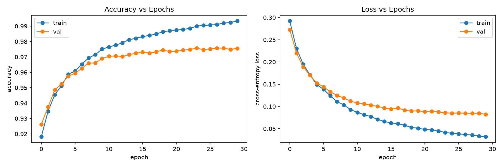
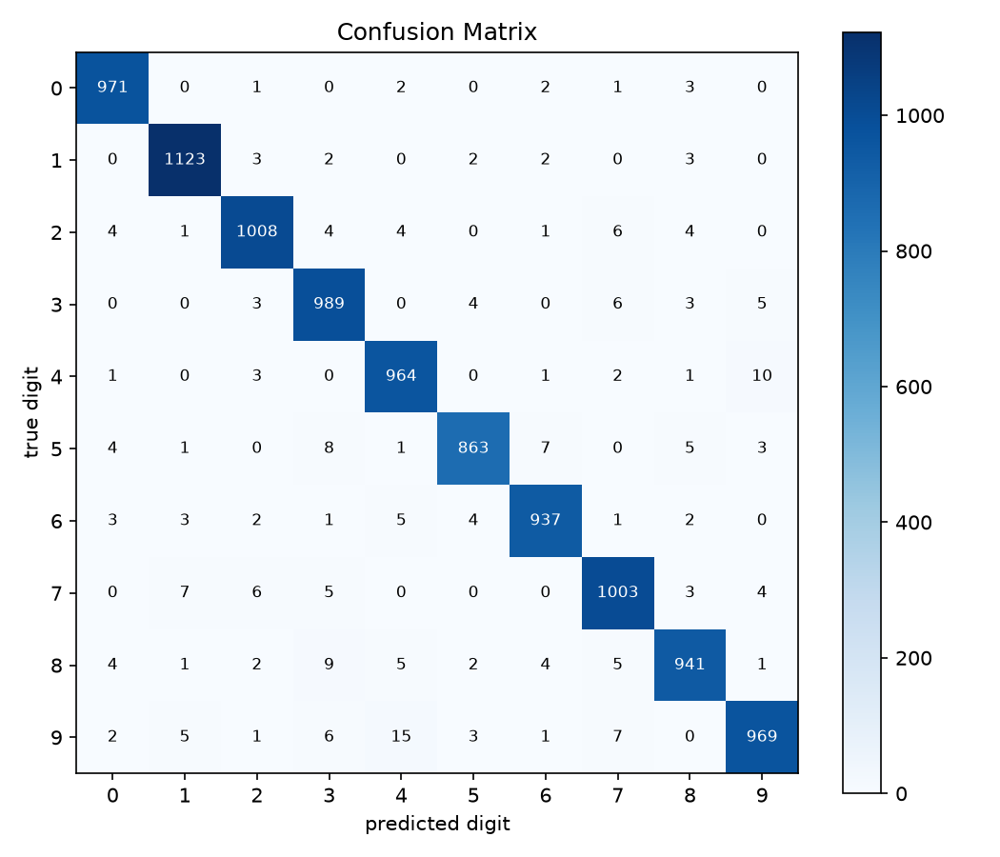
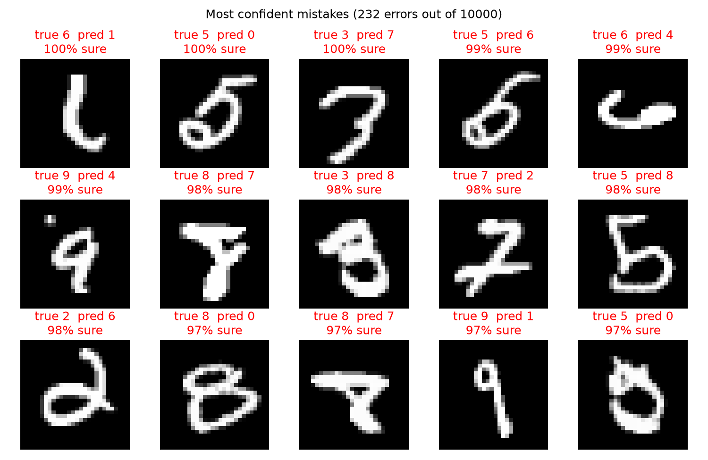

# Neural network from scratch in NumPy

A fully connected neural network written with NumPy only, trained on MNIST. No PyTorch, TensorFlow, or scikit-learn models (scikit-learn is only used to download the data).

**Result:** 97.68% test accuracy on MNIST (232 mistakes out of 10,000) with a 784 → 128 → 10 network, trained for 30 epochs in about 19 seconds on a laptop.

## What's implemented

- Any number of layers, set with a tuple like `layers=(784, 128, 10)`
- ReLU hidden layers, with sigmoid output for binary tasks and softmax for multi-class (picked from the size of the last layer)
- Cross-entropy loss
- Backpropagation written by hand
- He initialization
- Mini-batch gradient descent with shuffling each epoch
- Train/validation accuracy and loss tracking during training

`gradient_check.py` checks the backprop against finite differences: nudge a weight up and down by a tiny amount, measure how the loss changes, and compare with the gradient from backprop. For both a sigmoid network and a softmax network, the two agree to about 1e-11 in every layer.

## Files

| file | what it is |
|---|---|
| `neuralnet.py` | the `NeuralNet` class |
| `mnist.ipynb` | trains on MNIST and makes the figures below |
| `onelayer.py` | my first version: one hidden layer with every gradient written out by name, trained on a 2D "two circles" dataset that logistic regression can't separate |
| `test.py` | quick check on scikit-learn's small 8×8 digits dataset |
| `gradient_check.py` | compares backprop gradients with finite-difference estimates |

## Results

Learning curves. Validation accuracy mostly flattens after epoch 15 while training accuracy keeps going up, so later epochs are mostly fitting the training set.



Confusion matrix. The most common mistakes are 9 read as 4, 4 read as 9, and 8 read as 3.



The 15 test images the model got wrong while being most confident. A lot of these are hard for a person to read too.



## How backprop works here

Each layer computes `Z = A_prev @ W + b` and then an activation. The forward pass saves every layer's input `A` and pre-activation `Z`.

The backward pass starts from the output. With softmax (or sigmoid) and cross-entropy, the error at the last layer simplifies to `(P - Y) / n`. Then, going from the last layer to the first, each layer:

1. computes its weight gradient `A_prev.T @ dZ` and bias gradient `dZ.sum(axis=0)`
2. sends the error back through its weights, `dZ @ W.T`
3. multiplies by the ReLU derivative of the layer below, `(Z_prev > 0)`

That gives a gradient for every weight, and each one is updated with `W -= lr * dW`.

## Usage

```python
from neuralnet import NeuralNet

net = NeuralNet(layers=(784, 128, 10), lr=0.1, epochs=30, batch_size=128)
net.fit(X_train, y_train, X_val, y_val)
preds = net.predict(X_test)
```

## Running it

```bash
python -m venv venv
source venv/bin/activate
pip install -r requirements.txt
jupyter notebook mnist.ipynb
```

The first run downloads MNIST (about 50 MB) and caches it as `mnist.npz`.
